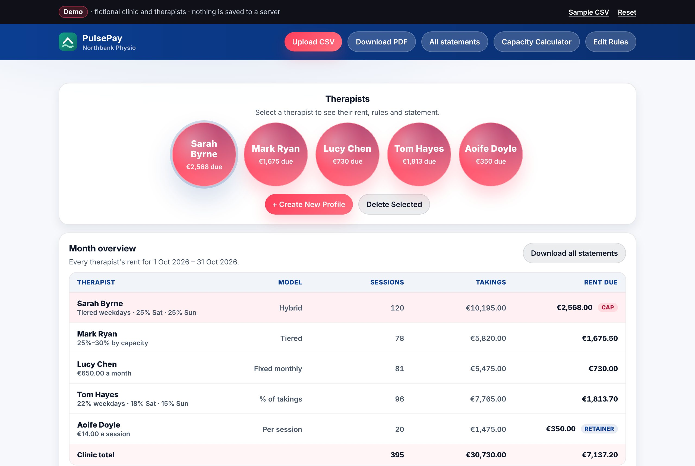
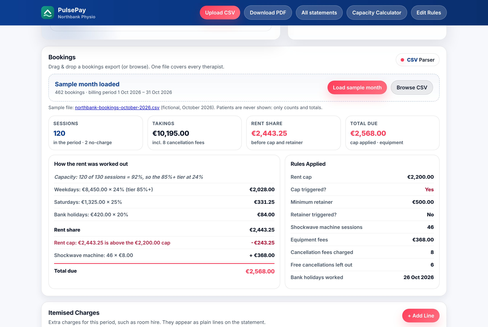
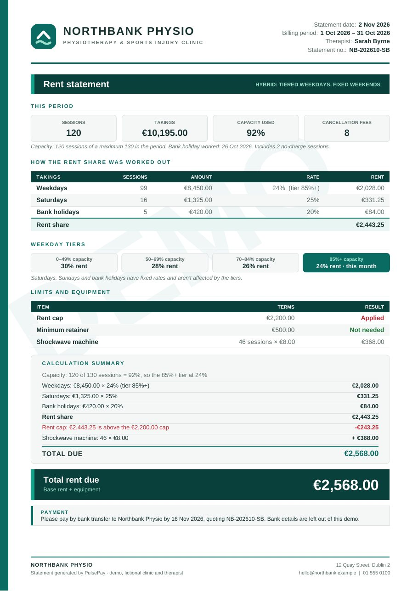
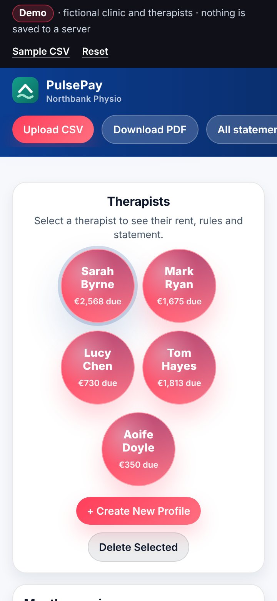
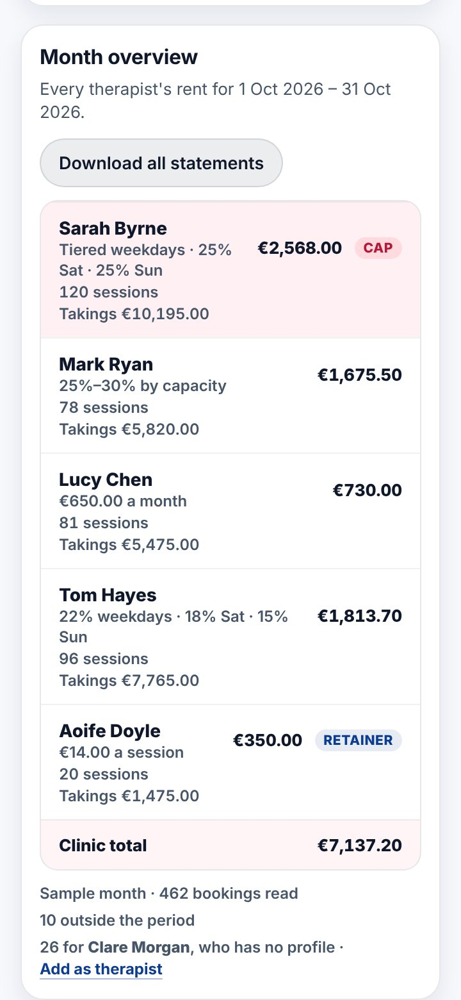

# PulsePay demo

A clickable copy of PulsePay, my rent and payout tool for clinics that rent rooms to self-employed therapists.

**[Live demo](https://cian-pulsepay-demo.vercel.app)** · **[Portfolio](https://cianmccaul.vercel.app)**



## What PulsePay is

In many physio and therapy clinics, the therapists aren't employees. They're self-employed and pay the clinic rent for their room, and every therapist has a different deal. One pays a share of takings, with lower rates at weekends. One pays a flat amount each month. One's rate drops as their diary fills up. Most have a cap, a minimum, and a fee for the shockwave machine.

At the end of each month someone exports the bookings, splits them by therapist and day of the week, applies each deal by hand in a spreadsheet, and writes a statement for every therapist. It takes hours, mistakes are easy to make, and therapists have to take the figures on trust.

PulsePay does it in one step. Load the month's bookings export and every therapist's rent is worked out at once, with a PDF statement that shows the calculation line by line.

This demo runs PulsePay on **Northbank Physio**, the fictional clinic from my other demos, with five made-up therapists and a made-up month of bookings. There's no login, no API and no server storage. Everything stays in your browser, and **Reset** in the demo bar starts over.

## Things to try

1. **Look at the month.** The sample October is already loaded. The **Month overview** lists every therapist's sessions, takings and rent due. Sarah Byrne is busy enough to hit her **rent cap**, and Aoife Doyle is quiet enough that her **minimum retainer** applies.
2. **Pick a therapist** (the bubbles, or a row in the overview). **How the rent was worked out** shows each step. **Rules Applied** shows the cap, the retainer, equipment fees, cancellation fees and bank holidays worked.
3. **Download a statement.** **Download PDF** gives the selected therapist's statement. **All statements** gives the whole clinic in one PDF, one page each.
4. **Change a deal.** **Edit Rules** switches between the five rent models and lets you edit rates, tiers, the cap, the retainer and equipment fees. Every figure updates as soon as you save.
5. **Add extra lines.** Add **Itemised Charges** (e.g. Saturday room hire) and **Manual Adjustments** (a credit is a negative amount). They appear on the statement.
6. **Try the capacity rules.** For Sarah or Mark, type a different number into **Sessions seen** and watch the tier and the rate change. The **Capacity Calculator** works out a therapist's maximum sessions from their hours.
7. **Change the billing period.** Under **Current Selection → Billing period**, choose a start day (e.g. the 15th to the 14th) and edit the bank holidays.
8. **Upload your own CSV.** Use any booking system's export. The **column mapper** guesses which column is the date, therapist, treatment, price and status, and you can change any of them. Names in the file without a profile can be added with one click. **Sample CSV** (in the demo bar) downloads the sample file to look at or edit.

## The five therapists

One per rent model, so the sample month shows every rule:

| Therapist | Rent model | Deal (fictional) | In the sample month |
|---|---|---|---|
| Sarah Byrne | **Hybrid** | Weekday rate by capacity tier (30% → 24%), 25% Saturdays and Sundays, 20% bank holidays; cap €2,200, retainer €500; shockwave €8 a session | 92% capacity, worked the October bank holiday, **rent cap applied** |
| Mark Ryan | **Tiered by capacity** | One rate for all takings: 30%, 27.5% from 60% capacity, 25% from 80%; laser hired at €60 a month | 71% capacity, so 27.5%, plus an adjustment |
| Lucy Chen | **Fixed monthly** | €650 a month; no cap or retainer | Plus two Saturdays of room hire as itemised charges |
| Tom Hayes | **Percentage of takings** | 22% weekdays, 18% Saturdays, 15% Sundays; cap €1,900, retainer €400; shockwave €8 a session | A credit for a day his room was closed |
| Aoife Doyle | **Fixed fee per session** | €14 a session; cap €900, retainer €350 | 20 sessions = €280, so the **€350 retainer applies** |

The export also has 26 bookings for Clare Morgan, the clinic director, who is paid by the clinic and has no profile. They show up as "not matched" instead of quietly disappearing.

## What's real vs simulated

| | In this demo | In the real PulsePay |
|---|---|---|
| Look and layout (header, therapist bubbles, hero with rule pills, capacity card, results, modals) | **Real.** `css/pulsepay.css` is the production stylesheet, with only the password screen and the old invoice template taken out | Same |
| Rent rules: day-of-week rates, capacity tiers, hybrid weekday/weekend split, fixed rent, cap, retainer, equipment fees, itemised charges, adjustments, hand-entered session count | **Real rules, generalised** into a pure, tested module (`js/engine.js`). The fixed fee per session is new | Built into the page's script |
| Capacity calculator | **Real formula**: (hours − breaks) ÷ session length. The retainer per hour is configurable | Same, with a fixed rate per hour |
| Billing period | Configurable: 1st to end of month by default, or any start day | One fixed cycle |
| Bookings import | **Any CSV**, with a column mapper. One file covers the whole clinic | One booking system's export, one therapist at a time |
| Statement PDF | Vector PDF drawn from the engine's result, fictional clinic branding, "DEMO" watermark | The clinic's letterhead, rendered from HTML |
| Therapists, deals, bookings, clinic | **All fictional.** Clients are IDs only and patients are never shown | The clinic's real therapists |
| Storage | `localStorage` in your browser, with **Reset** | A small API on Vercel with Blob storage |
| Login | None | A sign-in screen |

The real PulsePay signs staff in on the server: a signed HttpOnly session cookie, a protected API, and a rate-limited login. None of that exists in this demo.

**No network calls.** The CSV and PDF libraries and the Inter font are bundled in `public/vendor/` at pinned versions, and the sample month is embedded in the page. The Content-Security-Policy in `vercel.json` sets `connect-src 'none'`, so the browser would block any request to a server, even by mistake.

## How the engine works

`public/js/engine.js` is plain JavaScript with no DOM, storage, network or clock. The browser loads it as `window.PulsePayEngine`, and Node loads it with `require` for the tests. The dashboard and the PDF both print from the result it returns, so they can't disagree.

```
CSV rows ──normaliseRows()──▶ bookings ──summarise()──▶ per-therapist totals ──calculateRent()──▶ rent, step by step
            column mapping                 period, bank holidays                 rules + this period's
            date order                     weekday / Sat / Sun / BH               extra lines
```

1. **Read the export.** `findHeaderRow()` skips any title lines above the headers. `guessMapping()` matches column names such as *Appointment Date*, *Practitioner* or *Amount (EUR)* to fields. `normaliseRows()` reads each row: dates in ISO, day-first, month-first or written form, and amounts like "€1,234.50", "45,00" or "(35.00)". Rows it can't read are listed with the reason, and patient columns are never copied.
2. **Count each booking.** Seen and charged is a session with takings. "No charge" or €0 is a session with no takings. A cancellation or no-show with a fee adds the fee to takings but isn't a session. A free cancellation, refund or negative amount is left out. Each booking is then sorted into weekday, Saturday, Sunday or bank holiday, using the calendar date in UTC, so the time zone of the computer doesn't matter.
3. **Work out the rent share** for the therapist's model:
   - **Percentage of takings**: each day type × its rate. Bank holidays use their own rate or the weekday rate.
   - **Fixed monthly**: the flat amount.
   - **Fixed per session**: sessions × fee.
   - **Tiered by capacity**: capacity = sessions ÷ max sessions, rounded to a whole percent. The tier with the highest starting point at or below it sets one rate for all takings.
   - **Hybrid**: the tier rate on weekdays, and fixed rates on Saturdays, Sundays and bank holidays.
4. **Apply the limits**: the rent cap first, then the minimum retainer. Neither applies to a fixed monthly rent.
5. **Add the extras**: equipment fees (per session for treatments that name the machine, or per month), then itemised charges, then adjustments.

Money is in whole cents throughout, and each multiplication is rounded to the cent straight away (halves round up), so a statement's lines always add up to its total. Every result includes `steps`, the calculation written out in order. That's what **How the rent was worked out** and the PDF's *Calculation summary* print.

## Tests

```
npm test
```

**122 tests in 6 files**, all passing, on Node's built-in test runner with no dependencies:

| File | Tests | Covers |
|---|---|---|
| `rent-models.test.js` | 27 | Every rent model worked by hand: day rates, bank holidays, rounding, tier boundaries (69.4% vs 69.5%), over-capacity, unordered tiers, hybrid splits |
| `limits-and-extras.test.js` | 23 | Rent cap and retainer (including exactly at the cap, no cap, retainer above cap), equipment per session and per month, itemised charges, credits and debits, negative totals, hand-entered sessions |
| `import.test.js` | 24 | Money formats, column guessing for different booking systems, header rows below titles, skipped rows, booking statuses, name matching ("Byrne, Sarah", accents, titles) |
| `dates-and-periods.test.js` | 20 | Date formats, leap years, weekdays across the clock change, bank holidays on weekends, period boundaries (both ends included, mid-month periods, December into January) |
| `rules-and-clinic.test.js` | 20 | Rules validation, the capacity calculator, and the whole sample month end to end |
| `pdf.test.js` | 8 | Builds the statements with the bundled jsPDF and checks each page's text against the engine: names, period, every step, totals, the watermark, page breaks |

## Run it locally

```
npm start
```

Then open http://localhost:8080. `scripts/serve.js` is a small static server with no dependencies that sends the same security headers as Vercel. Any static server works too: `cd public && python3 -m http.server 8080`.

To regenerate the sample month (seeded, so it's the same every time): `npm run sample`.

## Project layout

```
public/
  index.html                 the dashboard markup, plus the demo bar, month overview and new modals
  css/pulsepay.css           the production stylesheet
  css/demo.css               demo bar, month overview, column mapper, phone layout
  js/engine.js               the rent engine: pure, documented, tested
  js/statement-pdf.js        draws statement PDFs from the engine's result
  js/clinic-config.js        Northbank Physio, its five therapists and their deals
  js/app.js                  the screens: state in localStorage, events, modals
  js/sample-bookings.js      the sample export, embedded (generated)
  samples/*.csv              the same export as a downloadable file (generated)
  vendor/                    PapaParse 5.5.5, jsPDF 4.2.1, Inter (with their licences)
scripts/generate-sample.js   makes the sample month
scripts/serve.js             local server with the production headers
test/                        node --test
vercel.json                  security headers and caching for Vercel
```

There's no build step and no framework. The page loads about 150 KB of its own code, the 47 KB sample month and PapaParse (19 KB). jsPDF (420 KB) loads only when you first download a PDF.

## Deploy to Vercel

1. In Vercel, choose **Add New → Project** and import `cianmccaul/pulsepay-demo`.
2. Name the project **`cian-pulsepay-demo`**, so the URL is `https://cian-pulsepay-demo.vercel.app` like the other demos.
3. Leave **Framework Preset** on *Other*, the build command empty and the install command empty. With no build step, Vercel serves the `public/` folder, and `vercel.json` adds the headers.
4. Click **Deploy**. Every push to `main` redeploys, and every branch gets a preview URL.

To check the headers after deploying, run `curl -sI https://cian-pulsepay-demo.vercel.app | grep -i content-security`. You should see `connect-src 'none'`.

## More screenshots

| | |
|---|---|
|  |  |
| Sarah's rent, step by step, next to the rules applied | Her statement PDF, with the same steps |

On a phone (360 px):

<p>
  
  
</p>

---

Built by [Cian McCaul](https://github.com/cianmccaul). See also the [Northbank Physio clinic platform demo](https://github.com/cianmccaul/clinic-platform-demo), whose fictional clinic and therapists appear here.
